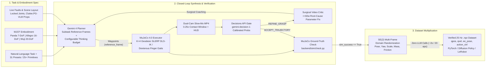

# Robo Genierator: Closed-Loop Cross-Embodiment Trajectory Synthesis & Visual Self-Correction

**Simulator-verified manipulation trajectory synthesis, calibrated multimodal self-correction, and $SE(2)$-equivariant multi-object domain randomization in MuJoCo 4.**

**Authors:** **Simon Tebeck** (Cornell University) · **Ujwal Konanur Vinay** (UMass)

---

## Why Simulated Expert Trajectories Matter for Robot Learning

Modern visuomotor robot policies—**Diffusion Policy**, **Action-Chunking Transformers (ACT)**, **RoboMimic**, and **Vision-Language-Action (VLA)** models ($\pi_0$, OpenVLA)—depend heavily on dense, physically valid state–action trajectories $\tau = \{(s_t, o_t, a_t)\}_{t=1}^T$. Collecting these demonstrations via human teleoperation (VR controllers, leader–follower arms, exoskeleton gloves) creates three severe research bottlenecks:

1. **Embodiment Lock-In:** Teleoperation rigs built for a 7-DoF parallel-jaw arm cannot generate demonstrations for a 16-DoF 4-fingered Allegro hand, a 20-DoF 5-fingered anthropomorphic Wuji hand, or a robot operating with a locked/damaged joint.
2. **Silent Physics Failures in Open-Loop VLM Planning:** Vision-Language Models (VLMs) reason well about task structure and physical affordances, yet open-loop VLM waypoint generation routinely fails in contact-rich simulation due to jaw-yaw misalignment on rotated objects, wrist-vs-fingertip TCP offsets, premature/late gripper closure, or workspace overhang collisions.
3. **Multi-Object Generalization:** Naive action replay breaks as soon as objects move. Even single-object relative offsets fail on **multi-object tasks** (e.g., stacking block $A$ onto block $B$ or placing a mug onto a movable pad) when *both* objects shift and rotate across episodes.

**Robo Genierator** turns a VLM + physics simulator into an automated, **zero-false-positive expert demonstration factory**:
- **Stage 1 — Cross-Embodiment Synthesis:** A **Gemini 4 Planner** reads live MuJoCo kinematic/geometric metadata (bounding boxes, object yaw, recommended grasp axis, joint limits, injected faults, and PG-VLM physical properties) and proposes 4–7 subtask-anchored 6-DoF waypoints or cyclic multi-finger gaits.
- **Stage 2 — Physics Execution & Multimodal Self-Correction:** MuJoCo 4.0 executes the trajectory via warm-started geodesic (`SLERP`) damped least-squares IK or multi-finger impedance control, rendering a contact-slowed dual-camera MP4 (`0.25x–0.35x` around grasp/close with `GRIP:OPEN/CLOSED` HUD telemetry). A calibrated **Decisions API gate (`gemini-decision-1`)** and concise **Gemini 4 Video Critic** diagnose physical root causes until **both** the visual critic and strict MuJoCo ground-truth predicates (`backend/sim/check.py`) pass.
- **Stage 3 — Zero-LLM-Cost $SE(2)$ Multi-Object Domain Randomization:** Once *one* trajectory is verified, `backend/sim/domain_rand.py` applies **MimicGen-style subtask reference-frame transforms** (`target_object` $\to$ `target_pad` / `base_block` / `bin` / `lock`) with $SE(2)$ yaw equivariance to synthesize **20+ diverse, simulator-verified 25 Hz `.npz` trajectories in ~2 seconds** with **zero additional LLM calls**—even when multiple objects and target zones translate and rotate independently.

---

## System Architecture



---

## Key Capabilities for Robotics Researchers

### 1. Three Distinct Embodiments with Unified Pinch-TCP Semantics
All three robots share a unified object-centric Tool Center Point (`ee_site`) placed at the **actual closed-finger pinch/cage centroid** (rather than the wrist flange), so `position_offset = [0, 0, 0]` places the active grasp envelope directly onto the target across embodiments:
- **`franka_emika_panda`** (7-DoF arm + parallel-jaw gripper): Warm-started `K = 4` Cartesian sub-stepped damped least-squares IK (`mujoco.mj_jacSite`) with geodesic $SO(3)$ SLERP orientation interpolation, nullspace home-posture regularization, automatic jaw-yaw alignment to narrow object axes, and disabled-joint Jacobian column masking.
- **`wonik_allegro`** (16-DoF 4-finger Wonik Allegro right hand): Supports both mocap-welded tabletop grasping/placement and palm-up (`18°`-tilted) cyclic finger-gait in-hand object rotation with **MuJoCo `SimState` receding-horizon checkpointing** (`qpos`, `qvel`, `ctrl` snapshots stitched into continuous MP4 and `.npz` demonstrations).
- **`wuji_hand`** (20-DoF 5-finger anthropomorphic right hand): Full 5-finger independent curl overrides (`thumb`, `index`, `middle`, `ring`, `little`), opposed thumb CMC kinematics, and 4D torsional fingertip pad friction.

### 2. MimicGen-Style Multi-Object Subtask Frames & $SE(2)$ Equivariance
Single-anchor relative trajectories fail when a task involves two or more movable entities (e.g., picking a cube at $\mathbf{p}_{\text{obj}}$ and stacking it onto a base block at $\mathbf{p}_{\text{base}}$, or placing a mug onto a shifted target pad $\mathbf{p}_{\text{pad}}$).

Every `Waypoint` in [`backend/schemas.py`](backend/schemas.py) carries an explicit `reference_frame` anchor (`"target_object"`, `"target_pad"`, `"base_block"`, `"bin"`, `"bowl"`, `"lock"`, `"hole"`, `"clutter_1".."clutter_5"`, `"stack_1".."stack_3"`, or `"world"`). During Domain Randomization, if frame $f$ translates to $\mathbf{p}_f^{\text{ep}}$ and rotates in yaw by $\Delta\psi_f = \psi_f^{\text{ep}} - \psi_f^{\text{demo}}$, [`backend/sim/domain_rand.py`](backend/sim/domain_rand.py) transforms each waypoint equivariantly in $SE(2)$:

$$\mathbf{p}_{\text{target}}^{\text{ep}} = \mathbf{p}_f^{\text{ep}} + R_z(\Delta\psi_f)\,\Delta\mathbf{p}_{\text{demo}}, \qquad \psi_{\text{target}}^{\text{ep}} = \psi_{\text{demo}} + \Delta\psi_f$$

Pick waypoints (`1..4`) track `"target_object"`, while transport/place/release waypoints (`5..7`) track `"target_pad"` or `"base_block"`, enabling zero-shot transfer across simultaneous multi-body pose, yaw, scale ($\pm 10\%$), mass ($\pm 25\%$), and friction ($\pm 25\%$) perturbations.

### 3. Procedural Object & Task Library + Text-to-MJCF Asset Forge
- **25+ Primitive-Built Objects** ([`backend/library/objects.py`](backend/library/objects.py)): Built purely from MuJoCo primitives (zero external object mesh downloads) and annotated with **[PG-VLM](https://iliad.stanford.edu/pg-vlm/) physical concepts** (`material`, `fragility`, `deformability`, `transparency`, `contents`, `can_contain_liquid`, `sealed`). Includes articulated mechanisms (`drawer`, `button_panel`, `valve`, `dial`, `jar_lid`), insertion puzzles (`key` + `lock`, `round_peg`/`square_peg` + `shape_board`), tools (`power_screwdriver` with spring trigger, `hammer` + `nail`), granular media (`cup_beads` + `bowl`), and mass-reasoning (`cans_three`).
- **31 Task Presets & Ground-Truth Evaluators** ([`backend/library/tasks.py`](backend/library/tasks.py), [`backend/sim/check.py`](backend/sim/check.py)): Deterministic `snapshot()` / `evaluate()` physics predicates verify every goal (`lift`, `zone`, `stack_on`, `tower`, `sort`, `clutter_pick`, `drawer_open`, `drawer_place`, `key_turn`, `peg_hole`, `button`, `pour`, `heaviest`, etc.).
- **Gemini Asset Forge** ([`backend/sidequest/asset_forge.py`](backend/sidequest/asset_forge.py)): Generates new multi-part MuJoCo objects from natural language, validates static stability in simulation, renders thumbnails, and persists them to `backend/library/generated/`.

---

## Quickstart & Installation

### 1. Create Environment & Install Dependencies
```bash
conda create -n gemini4nyc python=3.11 -y
conda activate gemini4nyc
pip install -r backend/requirements.txt
```

### 2. Configure Gemini API Key
Copy `.env.example` to `.env` in the repository root (gitignored; hot-reloaded on every call and logged to `outputs/logs/gemini_calls.jsonl` without ever exposing keys):
```bash
cp .env.example .env
# Edit .env and set: GEMINI_API_KEY=your_actual_api_key
```

### 3. Download Robot MJCF Assets (One Command)
Robot meshes (`franka_emika_panda` and `wonik_allegro` from `mujoco_menagerie`, plus `wuji_hand` from `wuji-hand-description`) are fetched at pinned commits and verified in MuJoCo:
```bash
python scripts/setup_assets.py --check
```

### 4. Run Automated Test Suite (`pytest`)
Verify all 3 embodiments, multi-object layouts, Cartesian IK sub-stepping, $SE(2)$ reference frames, ground-truth evaluators, and FastAPI routes offline (zero API cost, `<20s`):
```bash
MUJOCO_GL=egl pytest -v
```

---

## Command-Line Workflows

### 1. Closed-Loop Trajectory Synthesis & Domain Randomization (`run_loop.py`)
```bash
# Obstacle-guarded Panda grasp (overhang shelf forces angled -X entry & retract) + 20x DR
python backend/agents/run_loop.py --task-type obstacle_grasp --seed 42 \
  --planner models/gemini-4-neon --critic models/gemini-4-hydrogen \
  --thinking medium --mode video --max-attempts 4 --dr-episodes 20

# Multi-object 2-body block stacking (MimicGen reference_frame="base_block") + 20x 2-object DR
python backend/agents/run_loop.py --robot franka_emika_panda \
  --library-object cube --library-task stack_on_block \
  --planner models/gemini-4-neon --critic models/gemini-4-hydrogen --dr-episodes 20

# Simultaneous mug + target-pad randomized pick-and-place (reference_frame="target_pad") + 20x DR
python backend/agents/run_loop.py --robot franka_emika_panda \
  --library-object mug --library-task place_on_pad \
  --planner models/gemini-4-neon --critic models/gemini-4-hydrogen --dr-episodes 20

# 20-DoF 5-finger Wuji hand tabletop grasp + 10x DR
python backend/agents/run_loop.py --robot wuji_hand \
  --library-object cube --library-task pick_lift \
  --planner models/gemini-4-neon --critic models/gemini-4-hydrogen --dr-episodes 10

# Live actuator fault injection (lock Panda elbow joint4)
python backend/agents/run_loop.py --robot franka_emika_panda --seed 42 --disable joint4 \
  --planner models/gemini-4-neon --critic models/gemini-4-hydrogen --max-attempts 4

# Dexterous 16-DoF Allegro in-hand rotation (spindle & checkpointed receding-horizon chunks)
python backend/agents/run_loop.py --task-type in_hand_spindle --seed 42 --target-rotation 180 \
  --planner models/gemini-4-neon --critic models/gemini-4-hydrogen --dr-episodes 20
python backend/agents/run_loop.py --task-type in_hand_spindle --seed 42 --target-rotation 360 --chunk-deg 90
```

### 2. Inspect & Validate Exported `.npz` Datasets (`inspect_dataset.py`)
```bash
# Print Markdown table of episodes, horizon T, 25 Hz rate, state/action dims, and run NaN/motion checks
python scripts/inspect_dataset.py outputs/trajectories --check --export-summary outputs/dataset_summary.json
```

### 3. Scene Previews, Deterministic IK Smoke Tests & Asset Forge
```bash
# Render dual-camera PNG/MP4 previews or launch interactive 3D viewer (macOS: use mjpython)
python backend/sim/visualize.py --robot all --seed 42
python backend/sim/visualize.py --robot franka_emika_panda --seed 42 --mode viewer

# Deterministic IK grasp & fault-injection smoke tests (no API key required)
python backend/sim/test_grasp.py --robot franka_emika_panda --seed 42
python backend/sim/test_grasp.py --robot franka_emika_panda --seed 42 --disable joint4

# Generate a new MuJoCo primitive object from text and add it to backend/library/generated/
python backend/sidequest/forge_cli.py "a padlock with a U-shaped shackle" --save
```

### 4. Reproducible Evaluation Benchmark (`benchmark.py`)
Runs 3-arm feedback ablations (`one_shot` vs. `text_only` vs. `video`), Planner–Critic model-duo comparisons, 20-episode DR transfer sweeps, and stress tests across parallel EGL workers:
```bash
python backend/agents/benchmark.py --quick --workers 4
python backend/agents/benchmark.py --workers 4
```

---

## Interactive Research Studio (Web UI)

Launch the FastAPI backend and React/Vite studio to configure embodiments, browse PG-VLM objects, add multi-object clutter, shuffle seeded layouts, tune Gemini 4 thinking budgets (`minimal | low | medium | high`), stream live terminal & rollout videos over SSE, and inspect `.npz` datasets and benchmark tables:

```bash
# Terminal 1 — FastAPI backend (from repo root)
uvicorn app:app --app-dir backend --port 8000

# Terminal 2 — React + Vite frontend
cd frontend
npm install
npm run build   # optional production TypeScript + Vite verification
npm run dev     # http://localhost:5173 (proxies /api and /outputs to :8000)
```

---

## Exported `.npz` Trajectory Specification & Policy Loading

Every verified episode (and every passing Domain Randomization rollout) is saved as a compressed NumPy archive (`.npz`) sampled at **25 Hz** (`dt = 0.04 s`, every 20 MuJoCo physics steps at `2 ms` timestep), accompanied by `manifest.json` batch metadata in `outputs/trajectories/dr_<batch_id>/`:

| Key | Shape | Dtype | Description |
| :--- | :--- | :--- | :--- |
| `observation_qpos` | `(T, nq)` | `float32` | Full MuJoCo generalized positions (robot joints + free/articulated object DOFs) |
| `observation_qvel` | `(T, nv)` | `float32` | Full MuJoCo generalized velocities |
| `ee_pose` | `(T, 7)` | `float32` | End-effector / pinch-TCP pose `[x, y, z, qw, qx, qy, qz]` in world meters |
| `gripper_state` | `(T, 1)` | `float32` | Normalized gripper/hand closure command in `[0.0, 1.0]` |
| `action_ctrl` | `(T, nu)` | `float32` | Low-level actuator position/force commands (`nu=8` Panda, `16` Allegro, `20` Wuji) |
| `privileged_obj_pos` | `(T, 3)` | `float32` | Ground-truth 3D world position of `target_object` (for privileged critic / state BC) |
| `timestamps_s` | `(T,)` | `float32` | Simulation timestamps in seconds |
| `dt` | scalar | `float32` | Control timestep (`0.04` s = `25.0` Hz) |
| `robot_id` | scalar | `str` | Embodiment identifier (`franka_emika_panda`, `wonik_allegro`, `wuji_hand`) |
| `joint_names` | `(njnt,)` | `str` | Ordered MuJoCo joint names |
| `actuator_names` | `(nu,)` | `str` | Ordered MuJoCo actuator names |

### Minimal PyTorch / Diffusion Policy / LeRobot Loader
```python
import glob
import numpy as np
import torch
from torch.utils.data import Dataset


class SimTrajectoryDataset(Dataset):
    """Loads simulator-verified .npz demonstrations for Behavior Cloning / Diffusion Policy."""

    def __init__(self, folder: str = "outputs/trajectories"):
        self.samples: list[tuple[np.ndarray, np.ndarray]] = []
        for path in sorted(glob.glob(f"{folder}/**/*.npz", recursive=True)):
            with np.load(path, allow_pickle=False) as ep:
                qpos = ep["observation_qpos"]                           # (T, nq)
                qvel = ep.get("observation_qvel", np.zeros_like(qpos))  # (T, nv)
                ee = ep.get("ee_pose")                                  # (T, 7)
                grip = ep.get("gripper_state")                          # (T, 1)
                act = ep["action_ctrl"]                                 # (T, nu)
                parts = [qpos, qvel] + ([ee, grip] if ee is not None and grip is not None else [])
                obs = np.concatenate(parts, axis=-1).astype(np.float32)
                for t in range(len(act)):
                    self.samples.append((obs[t], act[t].astype(np.float32)))

    def __len__(self) -> int:
        return len(self.samples)

    def __getitem__(self, idx: int) -> dict[str, torch.Tensor]:
        obs, act = self.samples[idx]
        return {
            "observation.state": torch.from_numpy(obs),
            "action": torch.from_numpy(act),
        }
```

---

## Empirical Findings & Honest Failure Modes

Across our 26-episode unseen-seed cross-embodiment benchmark suite (`python backend/agents/benchmark.py --quick --workers 4`, saved to `outputs/benchmark_results.json` and viewable in the Studio **Evaluation Benchmark** tab):

### Zero-Shot Domain Randomization Transfer (1 Synthesized Skill $\to$ 20 Randomized Scenes, 0 LLM Calls)

| Embodiment | Task | Active Randomization | Verified Transfer Rate |
| :--- | :--- | :--- | :---: |
| **Franka Panda (7-DoF)** | `cube` / `stack_on_block` | Simultaneous 2-block XY pose, $SE(2)$ yaw, $\pm 10\%$ size, $\pm 25\%$ mass | **100% (20 / 20)** |
| **Franka Panda (7-DoF)** | `mug` / `place_on_pad` | Simultaneous mug pose/yaw + $\pm 3.5\text{ cm}$ target-pad shift + scale/mass | **75% (15 / 20)** |
| **Franka Panda (7-DoF)** | `obstacle_grasp` | Object XY pose, yaw, $\pm 12\%$ size, $\pm 25\%$ mass, $\pm 25\%$ friction under shelf | **70%–95% (14–19 / 20)** |
| **Wonik Allegro (16-DoF)** | `in_hand_spindle` (`90°`) | Cube scale ($\pm 8\%$), initial yaw, mass ($\pm 20\%$), fingertip friction ($\pm 25\%$) | **100% (20 / 20)** |
| **Wuji Hand (20-DoF)** | `cube` / `pick_lift` | 5-finger pinch grasp across shuffled tabletop XY pose, yaw, scale, and mass | **70% (14 / 20)** |

### Key Takeaways & Honest Failure Modes

1. **100.0% Critic–Simulator Agreement (`0.0%` False Accepts):** Combining the calibrated `gemini-decision-1` gate with `backend/sim/check.py` ground-truth predicates yielded **`100.0%` agreement (`0 / 29` false accepts)** across evaluated rollouts, ensuring failed physics rollouts never contaminate downstream policy training sets.
2. **Closed-Loop Self-Correction vs. One-Shot Planning:** Iterative feedback lifts unseen-seed task completion from **`57.1%` (`one_shot`)** to **`85.7%` (`text_only` / closed-loop)** within 3 attempts, solving multi-constraint overhang and jaw-alignment cases where `45°`-rotated box diagonals (`8.1 cm`) otherwise clip Panda's `8.0 cm` parallel-jaw opening on Attempt 1.
3. **Where Open-Loop Waypoints Break (Documented Stress Cases):**
   - **360° Free-Object In-Hand Rotation without High-Rate Tactile Feedback:** While 4-keyframe cyclic finger gaits reliably achieve `45°–90°` free-cube reorientation and `90°–360°` spindle rotation (`in_hand_spindle`, especially with `--chunk-deg 90` state checkpointing), unpinned free-cube `360°` rotation hits a dynamic stability boundary near `~150°–180°` where cumulative micro-slip requires high-frequency (`20–50 Hz`) reactive tactile/proprioceptive policy feedback—precisely motivating why researchers distill VLM-synthesized chunks into closed-loop neural policies!
   - **Compound Kinematic Singularity (`joint2` + `joint4` Simultaneously Locked):** Locking single joints is recoverable via nullspace/Cartesian IK adaptation, whereas locking both shoulder (`joint2`) and elbow (`joint4`) collapses reachable tabletop workspace (`ee_min_dist = 45.0 cm`); the Decisions API properly transitions to `GIVE_UP` rather than looping indefinitely.

---

## Repository Structure

```text
├── backend/
│   ├── app.py                  # FastAPI server: catalog, previews, SSE jobs, /api/benchmark, /api/datasets
│   ├── planner_hub.py          # UI -> PlannerBrief compiler & live worker subprocess bridge
│   ├── schemas.py              # Shared Pydantic contracts (Waypoint with reference_frame, ThinkingLevel)
│   ├── agents/
│   │   ├── gemini_client.py    # Unified Gemini SDK client (.env hot-reload, timeouts, ThinkingConfig, JSONL logs)
│   │   ├── planner.py          # Gemini 4 structured waypoint & 5-finger gait planner
│   │   ├── critic.py           # gemini-decision-1 gate + concise VisualCritique coach
│   │   ├── loop.py             # Single-horizon & SimState-checkpointed receding-horizon orchestrator
│   │   ├── run_loop.py         # Standalone CLI runner with StageSpinner & DR multiplier
│   │   └── benchmark.py        # Parallel multi-seed 3-arm ablation, model-duo & DR benchmark suite
│   ├── sim/
│   │   ├── scene_builder.py    # Procedural Panda/Allegro MJCF builder & kinematic/yaw/obstacle summarizer
│   │   ├── executor.py         # K=4 geodesic SLERP DLS-IK, multi-frame resolver, slow-mo HUD renderer, .npz exporter
│   │   ├── check.py            # Deterministic ground-truth evaluators across 31 task goals
│   │   └── domain_rand.py      # SE(2)-equivariant multi-object Domain Randomization multiplier + manifest.json
│   ├── library/                # 25+ primitive PG-VLM objects, 31 tasks, Wuji 20-DoF scene, seeded multi-object layout
│   └── sidequest/              # Text-to-MJCF Gemini Asset Forge + physics stability verifier
├── frontend/                   # React 19 + TypeScript + Tailwind Studio (LiveTerminal, ResearchDashboard)
├── scripts/
│   ├── setup_assets.py         # Zero-dependency downloader/verifier for Menagerie & Wuji MJCF assets
│   └── inspect_dataset.py      # Researcher CLI to audit, summarize, and load exported .npz datasets
├── tests/                      # 34+ offline pytest unit & physics integration tests (+ @pytest.mark.live)
└── config.yaml                 # Centralized model, camera, layout shuffle, and ground-truth check thresholds
```

---

## Asset Attribution & Licenses

Repository source code is released under the [Apache 2.0 License](LICENSE). Robot MJCF descriptions downloaded via [`scripts/setup_assets.py`](scripts/setup_assets.py) remain under their upstream licenses:

| Model | Source | License |
| :--- | :--- | :--- |
| `franka_emika_panda` | [`google-deepmind/mujoco_menagerie`](https://github.com/google-deepmind/mujoco_menagerie) | Apache License 2.0 |
| `wonik_allegro` | [`google-deepmind/mujoco_menagerie`](https://github.com/google-deepmind/mujoco_menagerie) | BSD 2-Clause (SimLab) |
| `wuji_hand` | [`wuji-technology/wuji-hand-description`](https://github.com/wuji-technology/wuji-hand-description) | MIT License (Wuji Technology) |

---

## Authors & Citation

- **Simon Tebeck** — Cornell University
- **Ujwal Konanur Vinay** — UMass

If this repository or its closed-loop trajectory synthesis pipeline is useful in your robotics research, please cite:

```bibtex
@software{tebeck2026robogenierator,
  author       = {Tebeck, Simon and Konanur Vinay, Ujwal},
  title        = {{Robo Genierator}: Closed-Loop Cross-Embodiment Trajectory Synthesis and Visual Self-Correction in {MuJoCo} 4},
  year         = {2026},
  url          = {https://github.com/SimTe8/robo-genierator},
  note         = {Cornell University and UMass}
}
```

*Originally created at the Gemini 4 NYC Hackathon (November 2026) and expanded for open-source robot learning research.*
